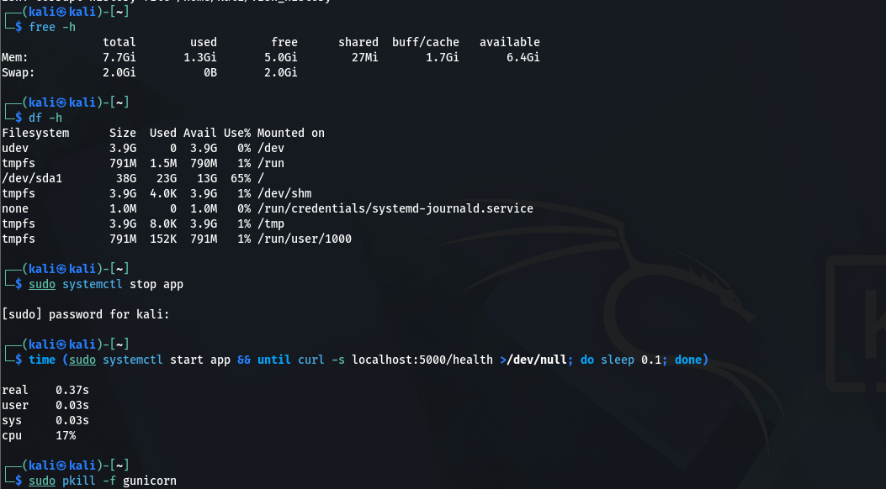
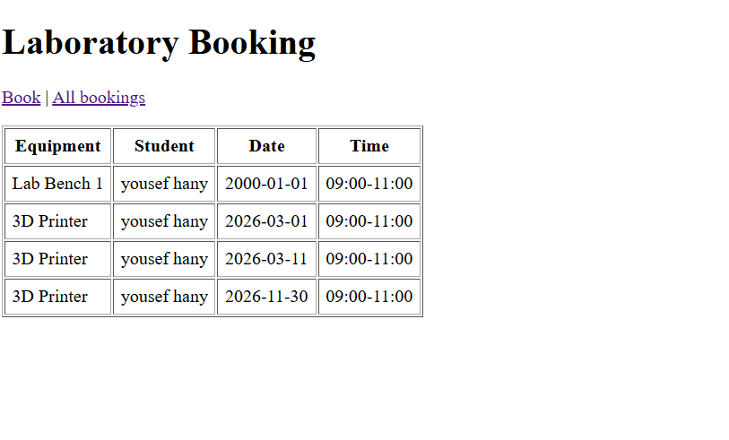
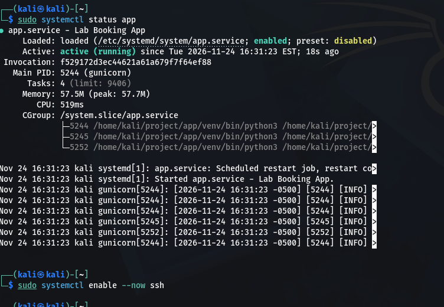

#####
problem and solution in vm
######

# Stage 1: Virtual Machine Deployment

Goal: run the Lab Booking service on a Linux VM, served through Nginx, with PostgreSQL on the same VM.

**Environment:** Windows host, Kali Linux VM (VMware, NAT network). User `kali`.
Replace `<DB_PASSWORD>` with your own password. Never commit it.

## 1. Network
VM adapter: NAT (host reaches the VM at its NAT IP, e.g. `192.168`).
Check with `ip a`. See "Problems" if the VM has no internet.

## 2. System update
```bash
sudo apt update && sudo apt upgrade -y
```

## 3. Remove Apache, install Nginx
Apache was preinstalled and occupied port 80.
```bash
sudo systemctl stop apache2
sudo systemctl disable apache2
sudo apt purge -y apache2 apache2-utils apache2-bin apache2-data
sudo apt autoremove -y
sudo apt install -y nginx git curl
sudo systemctl enable --now nginx
curl http://localhost
```
Browser on the host: `http://<VM-IP>` shows "Welcome to nginx!".

## 4. PostgreSQL
```bash
sudo apt install -y postgresql postgresql-contrib
sudo systemctl enable --now postgresql
sudo -u postgres psql
```
Inside psql:
```sql
CREATE USER appuser WITH PASSWORD '<DB_PASSWORD>';
ALTER DATABASE template1 REFRESH COLLATION VERSION;
ALTER DATABASE postgres REFRESH COLLATION VERSION;
CREATE DATABASE appdb OWNER appuser;
\q
```
Create tables (file `db/schema.sql`) and grant rights:
```bash
sudo -u postgres psql -d appdb -f schema.sql
sudo -u postgres psql -d appdb -c "GRANT ALL ON ALL TABLES IN SCHEMA public TO appuser; GRANT ALL ON ALL SEQUENCES IN SCHEMA public TO appuser;"
PGPASSWORD=<DB_PASSWORD> psql -h localhost -U appuser -d appdb -c "SELECT * FROM equipment;"
```

## 5. Python environment and application
```bash
sudo apt install -y python3 python3-venv python3-pip libpq-dev
mkdir -p ~/project/app && cd ~/project/app
python3 -m venv venv
source venv/bin/activate
pip install -r requirements.txt
```
Copy `app/app.py` to `~/project/app/app.py`. Quick test:
```bash
DB_PASSWORD=<DB_PASSWORD> python app.py
curl http://localhost:5000/health    # prints: ok
```

## 6. Nginx reverse proxy
Copy `vm/nginx-app.conf` to `/etc/nginx/sites-available/app`, then:
```bash
sudo rm -f /etc/nginx/sites-enabled/default
sudo ln -sf /etc/nginx/sites-available/app /etc/nginx/sites-enabled/app
sudo nginx -t && sudo systemctl reload nginx
```

## 7. Run the app as a service
Copy `vm/app.service` to `/etc/systemd/system/app.service` and set the real password in the `Environment=DB_PASSWORD=` line (on the VM only).
```bash
sudo systemctl daemon-reload
sudo systemctl enable --now app
sudo systemctl status app
```

## 8. Test from the host
Open `http://<VM-IP>`:
1. Reserve a piece of equipment: the booking appears in "All bookings".
2. Reserve the same equipment, date and time again: "This slot is already booked".

## Problems encountered and fixes
| Problem | Cause | Fix |
|---|---|---|
| Apache default page instead of Nginx | Apache2 preinstalled on port 80 | Stopped, disabled and purged Apache |
| `CREATE DATABASE` failed: collation version mismatch | glibc updated by `apt upgrade` | `ALTER DATABASE template1/postgres REFRESH COLLATION VERSION` |
| `pip install` failed: name resolution | VM had no connectivity to its NAT gateway | (Write here what fixed it, e.g. restarted VMware NAT/DHCP services or restored the virtual network) |
| `app.service` failed with status 203/EXEC | Placeholder `YOUR_USERNAME` left in paths | Replaced with `kali` |
| Nginx showed default page after setup | Proxy config not enabled | Removed `sites-enabled/default`, linked `app` config |

## Measurements for Table 7 (VM column)
| Measure | Value |
|---|---|
| Time to start the service | _fill in_ |
| Disk space used (`df -h /`) | _fill in_ |
| Memory used when idle (`free -h`) | _fill in_ |
| Behaviour when the application is stopped | _fill in (systemd `Restart=always` restarts it)_ |
| Effort to run four copies | _fill in (manual steps)_ |

## Screenshots (evidence)
- [ ] Nginx default page
- [ ] Booking page in the host browser
- [ ] "Already booked" message
- [ ] `systemctl status app` and `nginx`
